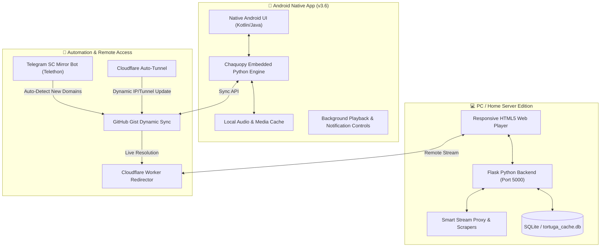

<div align="center">

# 🏴‍☠️ TortugaMusic
### Cross-Platform Audio Streaming Suite, Offline Player & Media Cloud

[](https://opensource.org/licenses/MIT)
[](https://github.com/robinandreoni/TortugaMusic/raw/main/TortugaMusic-v3.6-Release.apk)
[](https://www.python.org/)
[](https://flask.palletsprojects.com/)
[](https://chaquo.com/chaquopy/)
[](https://telegram.org/)

<br/>

> **TortugaMusic** is a complete, dual-platform audio streaming and media suite designed for both **Android (Native APK with embedded Python engine via Chaquopy)** and **PC / Home Server (Flask + Web Player)** with automated Telegram mirror synchronizers and Cloudflare tunnel remote access.

</div>

---

> [!NOTE]
> **DISCLAIMER & LEGAL NOTICE**  
> TortugaMusic is an open-source educational media framework. It does not host copyrighted media files. Streaming features query public endpoints and indexers. Users are solely responsible for ensuring compliance with copyright and local regulations when accessing media.

---

## 📋 Table of Contents

- [Ecosystem & Architecture](#-ecosystem--architecture)
- [📱 Android Edition (APK Direct Download)](#-android-edition-apk-direct-download)
- [💻 PC & Web Server Setup](#-pc--web-server-setup)
- [🤖 Telegram Mirror Bot Setup Guide](#-telegram-mirror-bot-setup-guide)
- [🌐 Cloudflare Tunnel & Mobile Remote Access](#-cloudflare-tunnel--mobile-remote-access)
- [🛠️ Building Android App from Source](#️-building-android-app-from-source)
- [📁 Project Layout](#-project-layout)
- [📄 License](#-license)

---

## 🏗️ Ecosystem & Architecture



---

## 📱 Android Edition (APK Direct Download)

The native Android app brings the full power of TortugaMusic directly to your phone:
* **Background Audio Playback:** Listen to music and podcasts continuously with the screen turned off.
* **Lock Screen & Notification Controls:** Integrated media session notification with play, pause, skip, and album art.
* **Embedded Python Runtime:** Runs scrapers and audio extractors locally on-device without needing an external server.
* **Offline Caching:** Download your favorite tracks and playlists locally for offline listening.

### 📥 Download & Install APK

1. Download the latest official release:
   👉 **[TortugaMusic-v3.6-Release.apk](https://github.com/robinandreoni/TortugaMusic/raw/main/TortugaMusic-v3.6-Release.apk)** *(72.5 MB, Android 7.0+)*
2. On your Android phone, open the downloaded APK file.
3. If prompted, allow *"Install from unknown sources"* in your browser or file manager settings.
4. Tap **Install** and launch TortugaMusic!

---

## 💻 PC & Web Server Setup

The PC edition runs a local web application that can be used on your computer or hosted on a local server.

### Prerequisites
* **Python 3.10+** ([python.org](https://www.python.org/))
* Git

### Step-by-Step Installation

1. **Clone the repository:**
   ```bash
   git clone https://github.com/robinandreoni/TortugaMusic.git
   cd TortugaMusic/PC
   ```

2. **Create a virtual environment (recommended):**
   ```bash
   # On Windows:
   python -m venv venv
   venv\Scripts\activate

   # On Linux / macOS:
   python3 -m venv venv
   source venv/bin/activate
   ```

3. **Install dependencies:**
   ```bash
   pip install -r requirements.txt
   ```

4. **Launch the Server:**
   * **On Windows (1-Click):** Double click **`AVVIA_TORTUGA_PC.bat`**
   * **Or via Terminal:**
     ```bash
     python run.py
     ```

5. **Open in Browser:**
   Navigate to **`http://localhost:5000`**

---

## 🤖 Telegram Mirror Bot Setup Guide

The optional Telegram bot monitors community mirrors and channels to ensure dynamic scrapers always point to working domains.

> [!IMPORTANT]
> **No personal credentials are stored in this repository.** To run the Telegram bot, you must configure your own Telegram API credentials.

### How to get your Telegram API credentials:
1. Go to **[my.telegram.org](https://my.telegram.org)** and log in with your phone number.
2. Click on **API development tools**.
3. Fill in the application form (any app name and short name will do).
4. Telegram will generate two values:
   * **`App api_id`** (a number, e.g. `12345678`)
   * **`App api_hash`** (a hexadecimal string)

### Configuring the Bot:
1. In `PC/`, copy `.env.example` to `.env`:
   ```bash
   cp .env.example .env
   ```
2. Open `.env` and fill in your values:
   ```env
   TELEGRAM_API_ID=12345678
   TELEGRAM_API_HASH=your_telegram_api_hash_here
   TELEGRAM_GROUP_LINK=https://t.me/your_target_channel
   
   # Optional GitHub Gist sync
   GITHUB_TOKEN=your_github_personal_access_token
   GIST_ID=your_gist_id
   GITHUB_USERNAME=your_github_username
   ```
3. Run the bot:
   * **Windows:** Double-click `START_BOT.bat`
   * **Linux / Mac:** `python telegram_sc_bot.py`
4. The first time you launch, Telethon will ask for your phone number and login code in the console. The session will be saved locally in `sc_bot_session.session` (automatically ignored by git).

---

## 🌐 Cloudflare Tunnel & Mobile Remote Access

Want to access your home PC's TortugaMusic library from anywhere in the world on your smartphone?

1. Install **Cloudflared** ([developers.cloudflare.com/cloudflare-one/connections/connect-networks/downloads/](https://developers.cloudflare.com/cloudflare-one/connections/connect-networks/downloads/)).
2. Run **`AVVIA_TORTUGA_ONLINE.bat`** (Windows) or **`./AVVIA_TORTUGA_ONLINE.sh`** (Android Termux).
3. The script starts a secure zero-configuration tunnel and automatically syncs the live URL to your Cloudflare Worker gateway (see `cloudflare_worker.js`).
4. Read **[`GUIDA_AVVIO_DA_TELEFONO.md`](PC/GUIDA_AVVIO_DA_TELEFONO.md)** for the complete guide on running the server directly inside Android Termux!

---

## 🛠️ Building Android App from Source

To compile the Android APK or AAB bundle yourself:

1. Open **Android Studio** (Hedgehog or newer recommended).
2. Select **Open an existing project** and choose the `android/` directory.
3. Ensure Android SDK 35/36 and JDK 17 are configured in Project Structure.
4. Let Gradle sync and download Chaquopy dependencies.
5. In the menu, click **Build $\rightarrow$ Build Bundle(s) / APK(s) $\rightarrow$ Build APK(s)**.
6. The generated APK will be placed in `android/app/build/outputs/apk/release/`.

---

## 📁 Project Layout

```text
TortugaMusic/
├── TortugaMusic-v3.6-Release.apk   # Ready-to-install Android Release APK
├── build_release.py                # Automated version & APK/AAB build script
├── BUILD_RELEASE.bat               # 1-Click release compiler
├── PlayStore_Assets/               # High-res icons, banners & promotional artwork
├── android/                        # Android Studio native app source
│   ├── app/
│   │   ├── src/main/java/          # Android Native Activities & Services
│   │   ├── src/main/python/        # Embedded Chaquopy Python Engine
│   │   ├── src/main/res/           # Layouts, themes, drawables & media styles
│   │   └── build.gradle
│   ├── build.gradle
│   └── settings.gradle
└── PC/                             # Web Player & Local Python Server
    ├── backend/                    # Scrapers, SQLite database, audio proxy
    ├── frontend/                   # HTML5 Audio/Video player and CSS styles
    ├── data/                       # Local playlists and catalog seeds
    ├── .env.example                # Template for Telegram & Gist credentials
    ├── run.py                      # Local server entry point
    ├── auto_tunnel.py              # Cloudflare Tunnel auto-synchronizer
    ├── cloudflare_worker.js        # Worker script for permanent domain routing
    ├── telegram_sc_bot.py          # Telethon mirror detector
    ├── AVVIA_TORTUGA_PC.bat        # 1-Click launcher (Local PC)
    ├── AVVIA_TORTUGA_ONLINE.bat    # 1-Click launcher (Cloudflare Tunnel)
    ├── AVVIA_TORTUGA_ONLINE.sh     # Android Termux mobile launcher
    └── requirements.txt            # Python dependencies
```

---

## 📄 License

This project is licensed under the **MIT License** — see the [LICENSE](LICENSE) file for details.  
Created by [Robin Andreoni](https://github.com/robinandreoni) & [Tortuga Italia](https://www.tortugaitalia.com).

